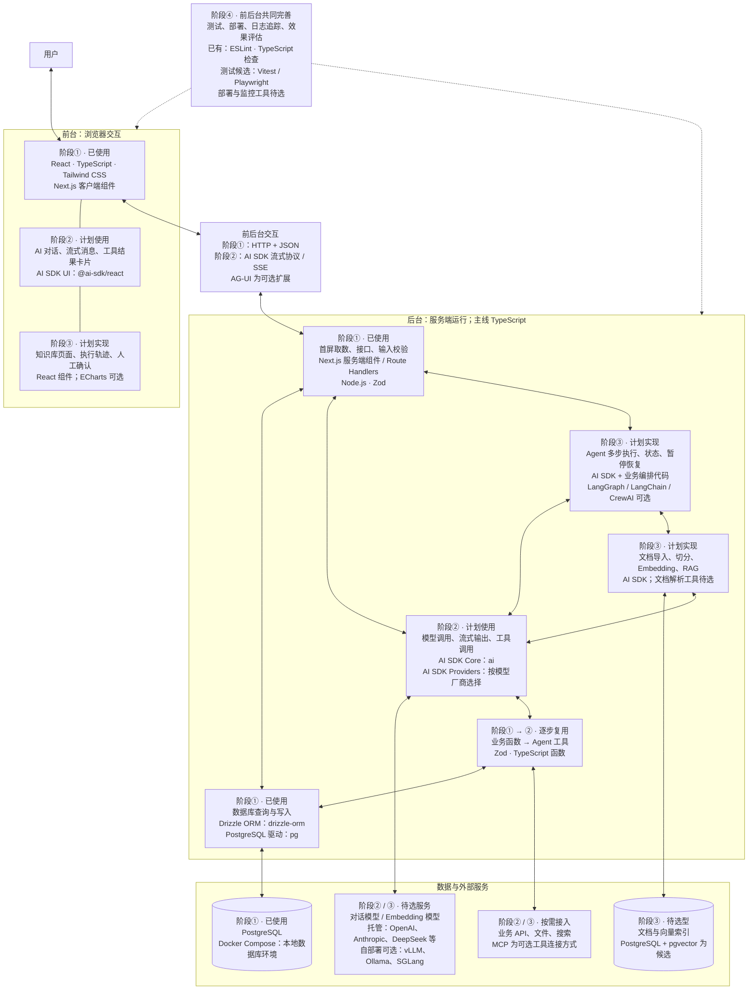

# Agent Workspace：应用架构与学习路线

这是一张用于学习和项目演进的目标架构，按前台、后台、数据与外部服务划分，模块内标注学习阶段、库与工具以及选型状态，不表示每个模块必须单独部署。阶段①为第 1–4 周，②为第 5–8 周，③为第 9–12 周，④为第 13–16 周。已使用以当前工程核查为准；计划使用尚未安装或实现；可选/候选/待选型不构成新增必学要求。前端和应用后端目前可以同在一个 Next.js 工程中。

## 16 周计划对应位置

| 阶段 | 周次与日期 | 对应架构 | 阶段产出 |
| --- | --- | --- | --- |
| 第一阶段 | 第 1–4 周，2026-10-19 至 2026-11-15 | 前端页面、应用接口、业务数据访问、业务数据库 | 打通页面到数据库，理解服务端边界、输入校验、错误处理和状态一致性 |
| 第二阶段 | 第 5–8 周，2026-11-16 至 2026-12-13 | AI 界面、流式通信、模型适配、工具执行及基础调用循环 | 多轮对话、流式展示、模型发起工具调用、程序执行并回传结果 |
| 第三阶段 | 第 9–12 周，2026-12-14 至 2027-01-10 | 知识入库、RAG、Agent 执行循环与运行管理、执行轨迹 | 基于知识库回答问题，组合工具完成任务，记录执行步骤；暂停确认等按项目范围逐项实现 |
| 第四阶段 | 第 13–16 周，2027-01-11 至 2027-02-07 | 贯穿全系统的工程保障与项目交付 | 关键测试、部署、日志与评估、项目演示、简历和面试讲解 |

工程保障会从第一阶段开始实践，第四阶段集中完善，并非到最后才开始测试。图中的会话权限、暂停恢复、成本限制等是目标架构职责；具体实现深度以 LEARNING.md 后续验收任务为准。

## 当前进度：2026-10-29

当前处于第一阶段第 2 周。已实践任务 CRUD、PostgreSQL/Drizzle、Zod 校验、服务端搜索、服务端页面首屏取数、客户端交互和加载/错误边界；数据库查询已通过 listTasks 在页面与 GET 接口之间复用。

当前两条主要路径：

- 首屏：服务端 page → listTasks → PostgreSQL → props → TaskDraft。
- 搜索：TaskDraft → 前端 getTasks/fetch → 后台 GET → listTasks → PostgreSQL → JSON 校验 → 更新界面。

这些是 Agent 应用的基础。当前任务状态是手动标记，不代表 Agent 已自动执行；尚未接入模型调用、RAG 或 Agent 执行循环。

下一项 URL 搜索参数任务已布置但暂缓，按学习者要求留待下一次学习。

## 选型与职责的区别

- Next.js 同时出现在前台与后台：客户端组件负责交互，服务端组件与 Route Handlers 在服务端执行；客户端组件首次加载仍可能参与服务端 HTML 预渲染。
- Vercel AI SDK 同时覆盖前台与后台：UI 包处理聊天流与界面状态，Core 与 Provider 包用于服务端模型、工具和流式响应。本项目主线使用 React UI 包；Vue 3 继续纳入原理复习，Vue 版 AI 界面并非额外必做项目。
- AG-UI 是可选交互协议，不等于 SSE 传输，也不自动定义 React/Vue 组件；它需要相应适配层，不与 AI SDK 流式协议默认视为同一种协议。
- LangGraph、LangChain、CrewAI 属于可选后台运行层方案，不要求三者并用。具体产品/语言版本在采用前另行核对，不改变本项目 TypeScript 主线。
- pgvector、ECharts、Vitest、Playwright 是对应模块的候选方案，尚未纳入当前安装依赖；部署平台、文档解析和监控工具尚未确定。

参考：[AI SDK 官方介绍](https://ai-sdk.dev/docs/introduction)、[AI SDK UI 与前端框架包](https://ai-sdk.dev/docs/ai-sdk-ui/overview)、[AG-UI 概览](https://docs.ag-ui.com/introduction)。

AG-UI 是可选的前后端交互协议；LangGraph、LangChain、CrewAI 是可选的运行层实现方案；MCP 是可选的工具连接方式。它们不是所有 Agent 应用必须同时引入的组件。当前计划以 TypeScript、Next.js 和 Vercel AI SDK 为主线，不因架构概览而提前引入所有框架。

图中的数据库与知识库是逻辑职责，后续可以根据需要选择同库或独立存储。图中的“运行管理”是将来的 Agent 执行状态，与当前手动 todo/done 状态分开理解。

